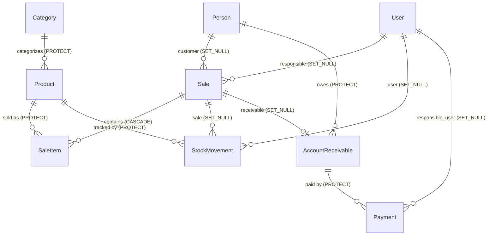

# quadrum Data Model

This document describes the database model implemented in `frontend/models.py`, the
invariants enforced around it, and how to change the schema safely. It is the
reference for a developer who needs to reason about the schema before modifying
it.

Verified sources: `frontend/models.py`, `frontend/services.py`,
`frontend/forms.py`, `frontend/migrations/0001`–`0007`, and the tests under
`frontend/tests/`.

Related documents: [Architecture](architecture.md) ·
[Business flows](business-flows.md) · [API reference](api-reference.md) ·
[Documentation index](index.md) · [Deployment](../DEPLOYMENT.md) ·
[Contributing](../CONTRIBUTING.md).

## A. Model overview

All models are defined in `frontend/models.py`. There are eight models.

| Model | Purpose | Role in the application |
|---|---|---|
| `Category` | Product grouping with an `active` flag | Referenced by `Product` (`PROTECT`) |
| `Product` | Sellable item, price, and stock level | Core catalog; source of prices and stock |
| `Person` | Customer/student/staff registry | Optional customer on `Sale`; owner of `AccountReceivable` |
| `Sale` | A sale header (status, method, totals, idempotency) | Transaction root; owns `SaleItem` |
| `SaleItem` | One line of a sale, with a captured unit price | Child of `Sale`; references `Product` |
| `StockMovement` | Audit log of stock changes | References `Product` and optionally `Sale`/`User` |
| `AccountReceivable` | Amount owed by a person for an on-account sale | Created for `ON_ACCOUNT` sales; owns `Payment` |
| `Payment` | A payment applied to a receivable | Child of `AccountReceivable` |

Timestamps: every model except `SaleItem` has `created_at`; `Category`,
`Product`, `Person`, and `AccountReceivable` also have `updated_at`
(`auto_now`). `Sale` has `created_at` and `completed_at`; `Payment` has
`payment_date` and `created_at`; `StockMovement` has `created_at`.

## B. Entity relationships

The relationships and cardinalities below are taken directly from the foreign
key definitions. `Sale.customer`, `Sale.responsible`, `AccountReceivable.sale`,
`StockMovement.sale`, and `StockMovement.user` are nullable.

`User` is Django's built-in `django.contrib.auth.models.User` (`config/settings.py`,
default `AUTH_USER_MODEL`).

### Deletion behavior

| Foreign key | on_delete | Effect |
|---|---|---|
| `Product.category` | `PROTECT` | A category with products cannot be deleted |
| `Sale.customer` | `SET_NULL` | Deleting a person leaves the sale, `customer = NULL` |
| `Sale.responsible` | `SET_NULL` | Deleting a user leaves the sale, `responsible = NULL` |
| `SaleItem.sale` | `CASCADE` | Deleting a sale deletes its items |
| `SaleItem.product` | `PROTECT` | A product referenced by a sale item cannot be deleted |
| `StockMovement.product` | `PROTECT` | A product with movements cannot be deleted |
| `StockMovement.sale` | `SET_NULL` | Deleting a sale keeps movements |
| `StockMovement.user` | `SET_NULL` | Deleting a user keeps movements |
| `AccountReceivable.person` | `PROTECT` | A person with receivables cannot be deleted |
| `AccountReceivable.sale` | `SET_NULL` | Deleting a sale keeps the receivable |
| `Payment.account_receivable` | `PROTECT` | A receivable with payments cannot be deleted |
| `Payment.responsible_user` | `SET_NULL` | Deleting a user keeps payments |

Note the asymmetry: `Sale` → `SaleItem` cascades, but everything that points at
`Product` uses `PROTECT`, so a product that has ever been sold or moved cannot be
deleted. Database-level deletes of sale history are not intended.

## C. Important fields and constraints

### Primary keys and generated identifiers

- Every model uses Django's default `BigAutoField` primary key (`id`).
- `Sale.code` is `CharField(max_length=20, unique=True, blank=True)`. It is
  generated in `Sale.save()` as `VEN-{pk:06d}` (for example `VEN-000042`) and is
  preserved on later updates.
- `Sale.idempotency_key` is `CharField(max_length=255, unique=True, null=True,
  blank=True, db_index=True)`. The unique index is the database-level guarantee
  against duplicate checkout requests.
- `Sale.request_fingerprint` is `CharField(max_length=255, null=True, blank=True,
  db_index=True)` — indexed but **not** unique.

### Unique constraints

| Constraint | Where | Notes |
|---|---|---|
| `Category.name` unique | model field | Verified by `test_category_unique_name` |
| `Product.code` unique | model field | `blank=True`, so multiple blank codes are only prevented when non-empty |
| `Sale.code` unique | model field | Generated, not user-supplied |
| `Sale.idempotency_key` unique | model field + DB index | Core idempotency guarantee |

### Check constraints and validation boundaries

| Rule | Enforced by | Level |
|---|---|---|
| `Product.stock_quantity >= 0` | `CheckConstraint(name='stock_non_negative')` | **Database** (migration `0002`) |
| `Product.stock_quantity >= 0` | `MinValueValidator(0)` on the field | Python (field validator; run by `full_clean`/forms) |
| `Product.minimum_stock >= 0` | `MinValueValidator(0)` | Python |
| `Payment.amount >= 0.01` | `MinValueValidator(Decimal('0.01'))` | Python |
| `Payment.amount <= remaining_balance` | `Payment.clean()` | Python (model `full_clean`) |
| `Payment.amount <= remaining_balance` | `PaymentForm.clean_amount()` | Python (form) |
| `Payment.amount <= remaining_balance` | `register_payment()` | Python (service, raises `ValueError`) |
| No payment on a `CANCELLED` receivable | `register_payment()` (locked row) | Python (service, raises `ValueError`) |
| New/reassigned payment on a `CANCELLED` receivable | `Payment.save()` (locked row) | Python (model, raises `ValidationError`) |
| New/reassigned payment on a `CANCELLED` receivable | `Payment.clean()` | Python (model `full_clean`) |
| `CANCELLED` is terminal in status recalculation | `AccountReceivable.update_status()` | Python (model) |
| `CANCELLED` receivables not selectable | `PaymentForm.account_receivable` queryset | Python (form) |

The only stock rule that exists at the database layer is the
`stock_non_negative` check constraint. The monetary and balance rules are
Python-level only — they are **not** database constraints.

### Decimal monetary fields

All money fields are `DecimalField(max_digits=10, decimal_places=2)`:
`Product.price`, `Product.cost_price`, `Sale.subtotal`, `Sale.discount`,
`Sale.total`, `SaleItem.unit_price`, `SaleItem.subtotal`,
`AccountReceivable.original_amount`, and `Payment.amount` (with the
`MinValueValidator(0.01)` noted above). The `Sale.discount` field exists on the
model but no code path in the current views/services sets it to a non-zero value.

### Status and choice fields

| Field | Values | Default |
|---|---|---|
| `Person.person_type` | `STUDENT`, `TEACHER`, `STAFF`, `VISITOR` | `STUDENT` |
| `Sale.status` | `PENDING`, `COMPLETED`, `CANCELLED` | `PENDING` |
| `Sale.payment_method` | `CASH`, `DEBIT`, `CREDIT`, `PIX`, `ON_ACCOUNT` | `CASH` |
| `StockMovement.movement_type` | `ENTRY`, `EXIT`, `ADJUSTMENT`, `SALE`, `RETURN` | `ADJUSTMENT` |
| `AccountReceivable.status` | `PENDING`, `PARTIAL`, `PAID`, `OVERDUE`, `CANCELLED` | `PENDING` |
| `Payment.method` | `CASH`, `DEBIT`, `CREDIT`, `PIX`, `TRANSFER` | `CASH` |

Choice values are stored as their short codes (for example `CASH`). Django does
not add a database constraint for `choices`, and nothing in migrations
`0001`–`0007` creates one, so the database accepts any string that fits the
column. Enforcement is application-level and varies by path:

- Forms validate choices via `full_clean`/`ModelForm` (for example
  `ProductForm`, `PersonForm`, `PaymentForm`).
- The two POS API views validate `payment_method` explicitly against
  `Sale.PAYMENT_METHODS`; unknown values, casing variants (`cash`), and
  leading/trailing whitespace (`"CASH "`) are rejected with `400` rather than
  normalized (see [API reference](api-reference.md)).
- Direct ORM writes (Django admin, services, management commands) are not
  choice-validated unless `full_clean` is invoked, so there is no
  path-independent guarantee.

### Computed and transaction-time values

- `SaleItem.subtotal` is recomputed on every `SaleItem.save()` as
  `Decimal(str(quantity)) * unit_price`. It is not stored by callers.
- `SaleItem.unit_price` is captured (frozen) at sale creation time. The service
  `create_sale_items()` always substitutes the product's current price, ignoring
  any client-supplied price.
- `AccountReceivable.amount_paid` is a property: the `Sum('amount')` of related
  payments, or `Decimal('0.00')`.
- `AccountReceivable.remaining_balance` is a property:
  `max(original_amount - amount_paid, Decimal('0.00'))` (never negative).
- `Product.is_low_stock` / `is_out_of_stock` are properties derived from `active`,
  `stock_quantity`, and `minimum_stock`.

### Legacy aliases

`Product` exposes Portuguese-named read-only properties `estoque`,
`estoque_minimo`, and `nome` that alias `stock_quantity`, `minimum_stock`, and
`name`. They exist for template compatibility and are not separate fields.

## D. Data invariants

Each invariant below is attributed to the layer that actually enforces it.

### 1. Stock is never negative

- **Database:** `stock_non_negative` check constraint (migration `0002`).
- **Service:** `reduce_stock()` (`frontend/services.py`) locks the product with
  `select_for_update()` and raises `ValueError` if `stock_quantity - qty < 0`
  before saving.
- **Field validator:** `Product.stock_quantity` has `MinValueValidator(0)`, and
  `ProductForm.clean_stock_quantity()` rejects negatives.
- **Not enforced by:** `adjust_stock()`. It applies a signed quantity with no
  lower-bound check, so a sufficiently negative adjustment can reach the database
  constraint and raise an `IntegrityError`. The inventory view catches the
  resulting exception and surfaces it as a message.

### 2. Monetary precision

All monetary values are 2-decimal `Decimal`s. `ProductForm.clean_price()` rejects
negative prices; `PaymentForm.clean_amount()` rejects amounts below `0.01`.
There is no database-level monetary check.

### 3. Sale item pricing and subtotal

- `create_sale_items()` ignores any supplied `unit_price` and uses
  `Product.price` (it also overrides a mismatched price explicitly),
  preventing client-side price manipulation. Verified by
  `test_api_pdv_requires_login_and_ignores_client_price`.
- `SaleItem.subtotal` is always `quantity * unit_price` via the model's `save()`.
  Verified by `test_sale_item_subtotal_computation`.

### 4. Payment amount limits

- A payment may not exceed the receivable's remaining balance. Enforced by
  `Payment.clean()`, `PaymentForm.clean_amount()`, and `register_payment()`.
- A payment may not target a `CANCELLED` receivable. Enforced by
  `register_payment()` (authoritative, checked on the locked row) and by the
  `PaymentForm.account_receivable` queryset, which excludes `CANCELLED` records so
  a submitted cancelled key fails with Django's invalid-choice error.
- A payment must be at least `0.01`. Enforced by the field validator and
  `PaymentForm`, but **not** by `register_payment()` itself (it does not call
  `full_clean()`), so calling the service directly with `0` is not rejected by
  that check.
- Verified by `test_payment_clean_rejects_over_balance`,
  `test_payment_form_over_balance`, `test_payment_amount_positive`, and
  `test_duplicate_payment_blocked`.

### 5. Accounts-receivable balance and status

`remaining_balance` is derived from the sum of payments and can never go
negative. Status transitions are described in
[Business flows](business-flows.md#f-accounts-receivable-and-cancellation). The
`status` field is only recomputed when `register_payment()` or `Payment.save()`
runs; there is no scheduled overdue sweep, so an overdue receivable stays
`PENDING`/`PARTIAL` until a write triggers recalculation.

`CANCELLED` is terminal: `update_status()` returns immediately when the status is
already `CANCELLED`, so a cancelled receivable stays cancelled even though it may
carry a positive `remaining_balance` (its sale was cancelled). Because
`Payment.save()` recomputes via `update_status()`, that recalculation cannot
reopen a cancelled receivable either. Verified by
`test_update_status_preserves_cancelled_with_balance` and
`test_update_status_recalculates_non_cancelled`.

**Protection boundaries for the no-payment-on-cancelled-receivable rule:**

- `PaymentForm.account_receivable` excludes `CANCELLED` records (UI).
- `register_payment()` raises `ValueError` after locking the receivable (finance
  service path; authoritative for that flow).
- `Payment.clean()` raises `ValidationError` when the payment is new or reassigned
  to a different receivable that is `CANCELLED` (model `full_clean`).
- `Payment.save()` raises `ValidationError` for the same condition, re-reading the
  persisted receivable under `select_for_update()` inside a transaction, so
  ordinary `Payment.objects.create()`/`instance.save()` cannot bypass the rule.
- Unrelated metadata edits to an existing payment (e.g. changing `notes`) are
  allowed even if its receivable later became `CANCELLED`; only new rows and
  receivable re-assignments are rejected. Verified by
  `test_direct_create_rejected_for_cancelled_receivable`,
  `test_direct_instance_save_rejected_for_cancelled_receivable`,
  `test_full_clean_rejects_new_payment_on_cancelled_receivable`, and
  `test_historical_payment_metadata_edit_allowed_after_cancellation`.

**Remaining limitation:** `Payment.objects.bulk_create()` and raw SQL bypass both
`Model.save()` and `Model.clean()`, so they can still insert a payment for a
cancelled receivable. No database trigger or constraint enforces this rule; it is
Python-level only. No such path exists in the current codebase.

### 6. Stock movement recording

Every stock mutation performed by the service layer writes a `StockMovement`
row in the same atomic block: `SALE` (negative quantity) in `reduce_stock()`,
`RETURN` (positive) in `cancel_sale()`, and `ADJUSTMENT` (signed) in
`adjust_stock()`. The `ENTRY` and `EXIT` movement types are defined in the model
but no current service creates them. Verified by
`test_inventory_adjustment_and_history` and `test_cancel_sale_idempotent_and_reversal`.

### 7. Sale identifiers and idempotency uniqueness

- `Sale.code` is unique and follows `VEN-{pk:06d}`, preserved across updates.
  Verified by `test_sale_code_generated_from_pk` and
  `test_sale_code_format_from_pk`.
- `Sale.idempotency_key` is unique at the database level; duplicate checkout is
  handled by catching `IntegrityError` (see
  [Business flows](business-flows.md#c-idempotency-and-retries)).

## E. Transactions and side effects

### `Sale.save()`

Generates `code` after the first insert and re-saves only the `code` field with
`update_fields=['code']`. It has no explicit transaction; the two writes rely on
the caller's context.

### `SaleItem.save()`

Recomputes `subtotal` before calling `super().save()`. No transaction of its own.

### `Payment.save()`

Before the base save, when the row is new or its `account_receivable` changes, it
re-reads the target receivable under `select_for_update()` inside a
`transaction.atomic()` block, raises `ValidationError` if that receivable is
`CANCELLED`, and otherwise calls `super().save()` **inside that same block**, so
the row lock is held until the payment insert commits when no outer transaction
exists. A direct `Payment.objects.create(...)`/`instance.save()` therefore cannot
insert a payment for a cancelled receivable. After the base save, if the row is
new or the `amount` changed, it refreshes the related `AccountReceivable`, calls
`update_status()`, and saves the receivable's `status`
(`update_fields=['status']`). That secondary write is only atomic if the caller
wraps it; `register_payment()` wraps it, a bare `Payment.objects.create(...)` does
not, though the sequence still runs synchronously.

### `Payment.clean()`

Beyond the amount/balance check, it raises `ValidationError` when the payment is
new or reassigned to a different receivable whose status is `CANCELLED`. It uses
an unlocked read (form/`full_clean` context); `Payment.save()` performs the locked
re-check on the write path. Unrelated metadata edits to an existing payment are
not blocked when only its receivable was later cancelled.

### `AccountReceivable.update_status()`

Pure computation plus an in-memory field assignment; it does **not** save. If the
current status is `CANCELLED` it returns immediately, leaving the status
untouched (terminal cancellation). Otherwise it recomputes `PAID`/`OVERDUE`/
`PARTIAL`/`PENDING` from the balance and due date. The caller is responsible for
persisting (`register_payment()` and `Payment.save()` both do).

### `register_payment(account_receivable, amount, method='CASH', user=None, notes='')`

Module-level function in `frontend/models.py`. Runs inside
`transaction.atomic()`, locks the receivable with
`AccountReceivable.objects.select_for_update().get(...)`, then raises `ValueError`
if the locked receivable's status is `CANCELLED`
(`'Cannot register payment for a cancelled receivable.'`), raises `ValueError` if
`amount > remaining_balance`, creates the `Payment`, then recalculates and saves
the status. The cancelled-status check runs before any write, so a rejected
attempt leaves the payment set, status, and balance unchanged. Concurrency safety
depends on the backend honoring `select_for_update` (PostgreSQL does; SQLite
effectively serializes writes). Verified by `test_payment_service_recalculates`
and `test_register_payment_rejects_cancelled_receivable`.

### Service operations (`frontend/services.py`)

Each of `reduce_stock`, `create_sale_items`, `cancel_sale`, `adjust_stock`, and
`finalize_sale` wraps its work in `transaction.atomic()` and locks the affected
rows with `select_for_update()`. `create_sale_items()` calls `reduce_stock()`,
which opens a nested atomic block (a savepoint). `finalize_sale()` creates the
`AccountReceivable` (`get_or_create`) for `ON_ACCOUNT` sales that have a
customer. `cancel_sale()` locks the sale, then its `ON_ACCOUNT` receivable (before
the payment-existence check and before marking it `CANCELLED`), then the product
rows — the same receivable lock used by `register_payment()`/`Payment.save()`, so
payment and cancellation serialize on that row (lock order sale → receivable →
products; the payment path locks only the receivable, so there is no cycle). If the
sale has no receivable, no receivable lock or payment check is performed.

### `api_pos_finalize` (`frontend/views.py`)

Wraps the entire create-items → finalize sequence in a single
`transaction.atomic()` block, so a failure rolls back the sale, sale items,
stock changes, movements, and any receivable together. This is the only place a
whole checkout is transactional as a unit. See
[Business flows](business-flows.md#b-sale-finalization) for the exact order.

## F. Migration history and safe schema changes

### Current sequence (`frontend/migrations/`)

| Migration | Purpose |
|---|---|
| `0001_core_models` | Initial schema for all eight models (original Portuguese verbose names/choice labels) |
| `0002_phase1_constraints` | Adds the `stock_non_negative` check constraint |
| `0003_add_sale_idempotency_key` | Adds `Sale.idempotency_key` (unique, indexed) |
| `0004_add_request_fingerprint` | Adds `Sale.request_fingerprint` (indexed) |
| `0005_translate_choice_values` | Rewrites model options and choice labels to English (`AlterModelOptions`/`AlterField`); changes schema metadata only, **not** existing rows |
| `0006_alter_accountreceivable_status_alter_payment_method_and_more` | Fixes choice labels and defaults to English (`CANCELLED`, `STUDENT`, `CASH`) |
| `0007_translate_existing_choice_values` | `RunPython` data migration translating legacy Portuguese values in existing rows to English |

### The data migration `0007`

`update_choice_values(apps, schema_editor)` maps:

- `Person.person_type`: `ALUNO→STUDENT`, `PROFESSOR→TEACHER`,
  `FUNCIONARIO→STAFF`, `VISITANTE→VISITOR`
- `Sale.payment_method`: `DINHEIRO→CASH`, `DEBITO→DEBIT`, `CREDITO→CREDIT`,
  `A_PRAZO→ON_ACCOUNT`
- `AccountReceivable.status`: `Cancelado→CANCELLED`
- `Payment.method`: `DINHEIRO→CASH`, `DEBITO→DEBIT`, `CREDITO→CREDIT`,
  `TRANSFERENCIA→TRANSFER`

It is written as idempotent `QuerySet.update()` calls, so re-running it is safe.
The migration declares no `reverse_code`, so it is **not reversible** — rolling
it back requires a forward plan. There is no evidence the migrations have been
exercised against a real production database; the behavior is verified by
`frontend/tests/test_migration_regressions.py`, which injects legacy values with
raw SQL and re-runs `update_choice_values`.

### Working with migrations in development

1. Change the model in `frontend/models.py`.
2. Generate a migration: `python manage.py makemigrations frontend`.
3. Inspect the generated file under `frontend/migrations/` before committing —
   confirm it does not drop or rename columns unexpectedly.
4. Apply locally: `python manage.py migrate`.
5. Run the suite: `python manage.py test` (the migration-regression tests and the
   schema-dependent model tests exercise the new state).
6. For complex changes, verify a fresh database builds from zero
   (`migrate` on an empty DB) as well as incrementally.

Do not rename or delete existing migrations that have been applied elsewhere, and
do not edit the app label `frontend` — table names such as `frontend_product`
depend on it.

For production migration and rollback procedures, see
[DEPLOYMENT.md](../DEPLOYMENT.md); this document does not duplicate the
operational runbook.
